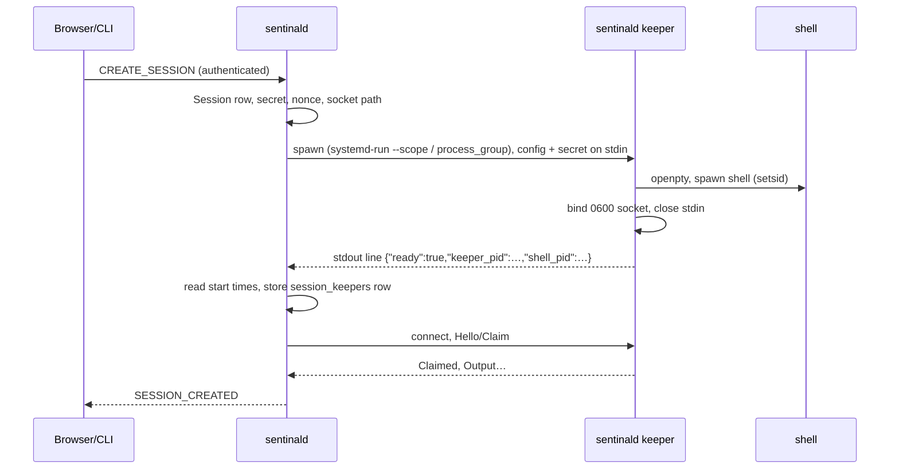

# R1 keeper design: terminals that survive a daemon restart

Status: **awaiting owner approval** (2026-10-23). Nothing here is implemented.
No production code, fixture, or service file changes until this is approved
(prompt 09 and milestone 4.G, section P1.1).

Inputs: `prompts/09-reliability-r1-daemon-restart-sessions.md` (required
review), `docs/PLAN_R1_TERMINAL_PERFORMANCE.md` section 1 (options), and the
owner decisions D1–D4 in `prompts/10-milestone-4g-terminal-reliability-performance.md`:

| | Decision used here |
|---|---|
| D1 | Option A: one keeper process per Session, as a `sentinald keeper` mode |
| D2 | Output ring of 1 MiB per keeper |
| D3 | A keeper with no daemon for 24 h ends its Session |
| D4 | On Linux, keepers run in their own `systemd-run --user --scope` |

---

## 1. Summary

Today `sentinald` owns every PTY: the master fd, the shell (its child), the
reader thread, the vt100 screen, and the log. When the daemon exits for any
reason, the masters close, the shells get SIGHUP, and the next start marks
every FULL Session INTERRUPTED (`store::interrupt_orphaned_sessions`).

With keepers, `sentinald` starts a small helper process per Session,
`sentinald keeper`, which owns only the PTY master, the shell, and a ring of
recent output. The daemon talks to it over a private Unix socket and keeps
every other responsibility. When the daemon restarts, it reconnects to each
keeper, checks that it is the same process with the same shell, replays the
output it missed, and carries on. The browser and CLI see no change except
that the Session is still RUNNING.

## 2. Options compared

| | A. Keeper per Session (proposed) | B. One shared supervisor | C. tmux/screen backend |
|---|---|---|---|
| Survives daemon update/crash | yes | yes | yes |
| Blast radius of a holder crash | that one Session | **every** Session | every Session in that server |
| Updating the holder itself | old keepers finish on old code; protocol is versioned | restarting it ends everything, so it can never be updated while terminals run | tmux upgrades break running servers (protocol mismatch) |
| New runtime dependency | none (same binary) | none | **tmux/screen on every Machine**, plus parsing its state model |
| Processes | one per live Session, ~1.3–2.4 MB each (measured, section 10) | one | one tmux server |
| Complexity | spawn, handshake, reclaim per Session | the same plus multiplexing and its own crash recovery | adapter around an external program we do not control |
| Verdict | **proposed** | rejected: a single point of failure that cannot be upgraded | rejected: new dependency and contract (prompt 09 expects this) |

Also considered and rejected in the plan: re-exec in place (does not survive
a crash) and the systemd file-descriptor store (Linux only, does not survive
a crash).

## 3. Who owns what

| Responsibility | Today | With keepers |
|---|---|---|
| PTY master fd | daemon | **keeper** |
| Shell process (child), its exit status | daemon (`portable-pty` child, `try_wait`) | **keeper** (waits for it, keeps the status until the daemon has it) |
| Reading PTY output | daemon reader thread | **keeper** reads; streams to the daemon |
| Ring of recent raw output (1 MiB) + last screen checkpoint | none | **keeper** |
| Raw log file (`sessions/<id>.log.zst`) | daemon | daemon |
| OSC parsing (shell hook signals, nonce check) | daemon | daemon |
| vt100 screen, scrollback, attach snapshots | daemon | daemon |
| Command/Event/Metric tracking and persistence | daemon | daemon |
| Authenticating and authorizing terminal input; input audit records | daemon | daemon (the keeper accepts input only from its authenticated daemon) |
| Network listeners, browser/CLI protocol | daemon | daemon only; the keeper has no network socket |
| Resize | daemon → PTY | daemon → keeper → PTY |
| Kill | daemon → child | daemon → keeper, which signals only the child it created |

The keeper never parses or interprets output. A keeper bug cannot corrupt the
screen, the log, or the database, and the keeper rarely needs to change, so
old keepers stay compatible for a long time.

## 4. Processes

### Process tree

```text
Linux (systemd --user)
  systemd --user
  ├─ sentinald.service            cgroup: sentinald.service
  │    └─ sentinald               network listeners, SQLite, vt100, logs
  ├─ sentinal-keeper-42.scope     cgroup of its own (D4)
  │    └─ sentinald keeper        PTY master, ring, private socket
  │         └─ zsh -l             session leader of the PTY (setsid by portable-pty)
  │              └─ cargo build …
  └─ sentinal-keeper-43.scope
       └─ sentinald keeper
            └─ bash

macOS (launchd)
  launchd
  ├─ sentinald                    job dev.sentinal.sentinald, process group P
  └─ sentinald keeper             own process group (not P)
       └─ zsh -l                  session leader of the PTY
```

- **Same binary.** The keeper is `sentinald keeper`: nothing new to package,
  sign, or update. The mode parses no config file, starts no tokio runtime,
  no tracing subscriber, and no listener except its socket. It uses two
  threads (PTY reader, socket) with std blocking I/O, because the workspace
  forbids `unsafe` (so no `poll` via `libc`).
- **Not a second network daemon.** The keeper binds only a Unix socket in a
  `0700` directory of the same user and accepts exactly one authenticated
  controller. It has no TCP listener, no browser protocol, and never reads a
  credential from the network.
- **Escaping the service's kill scope.**
  - Linux: systemd's default `KillMode=control-group` kills every process in
    the service cgroup on stop/restart, whatever its session or group. The
    daemon therefore starts each keeper with
    `systemd-run --user --scope --collect --quiet --unit=sentinal-keeper-<session-id> -- sentinald keeper`.
    The scope is its own cgroup, visible in `systemctl --user list-units`.
    Without systemd (or when `systemd-run` fails) the keeper is started
    directly; it then survives a crash but not a `systemctl` restart, and the
    Session says so (section 9).
  - macOS: launchd kills the job's process group when the job exits. The
    keeper is started with `process_group(0)` (std, no `unsafe`), the same
    way the 4.E worker updater already escapes a restart. The plist also
    gains `AbandonProcessGroup = true` as a second guard. P1.5 verifies both
    on this Mac.
- **What `sentinal uninstall` does.** Before removing the service, it asks
  the daemon to end every keeper (Kill to each, wait up to 5 s), then sends
  SIGTERM to any process left in `sentinal-keeper-*.scope` units (Linux) or
  listed in the keeper directory (macOS), and removes the directory.
  `--keep-data` keeps logs and the database as today.

### Socket location

| | Directory | Why |
|---|---|---|
| Linux | `$XDG_RUNTIME_DIR/sentinal/keepers/` (e.g. `/run/user/1000/sentinal/keepers/`) | per-user tmpfs, `0700`, removed on logout and reboot exactly when keepers die anyway |
| macOS | `confstr(_CS_DARWIN_USER_TEMP_DIR)/sentinal-keepers/` (`/var/folders/…/T/`) | per-user `0700`, short enough for the 104-byte `sun_path` limit; `~/Library/Application Support/…` is too long for long user names |
| Fallback | `<data_dir>/keepers/` | when the above is missing; refused if the full socket path exceeds the platform limit (the Session then uses `RealPty`, section 9) |

The directory is created `0700`. Socket file: `<session-id>.sock`, mode
`0600`. Before every connect the daemon checks that the directory and the
socket are owned by its own UID and not group/world accessible (std
`MetadataExt`, no `unsafe`). See section 7 for peer credentials.

## 5. Keeper protocol (IPC)

### Framing

Every message is one frame: 1 byte type, 4 bytes big-endian length, payload.

| Limit | Value | On violation |
|---|---|---|
| Max frame (any type) | 64 KiB | connection closed, nothing processed |
| Max handshake frame | 4 KiB | closed |
| Max unauthenticated time | 2 s | closed |
| Controllers at once | 1 | a newer authenticated claim replaces the older (`Superseded`) |

Control frames carry JSON (small, debuggable, `serde` already in the
binary). `Output` and `Input` carry raw bytes.

### Frames

| Type | Direction | Payload | Meaning |
|---|---|---|---|
| `0x00 Shutdown` | daemon → keeper | `{}` | **Fixed forever in every version**: hang up the child, exit. Lets any daemon end a keeper whose protocol it does not otherwise speak. |
| `0x01 Hello` | keeper → daemon | `{"protocol":1,"keeper_version":"0.3.0","session_id":42,"keeper_pid":51234,"shell_pid":51240,"nonce":"<32 hex>"}` | first frame on every connection |
| `0x02 Claim` | daemon → keeper | `{"protocol":1,"proof":"<64 hex>","daemon_boot":"<uuid>","resume_from":1048576}` | `proof` = HMAC-SHA256(secret, nonce); see section 7 |
| `0x03 Claimed` | keeper → daemon | `{"output_end":1300000,"ring_start":251424,"checkpoint_at":1290000,"size":[120,40],"exited":null}` | offsets are absolute byte counts since the shell started |
| `0x04 Replay` | keeper → daemon | raw bytes | ring bytes from `max(resume_from, ring_start)`; several frames |
| `0x05 Output` | keeper → daemon | raw bytes | live output, in order, offset implied |
| `0x06 Input` | daemon → keeper | raw bytes | written to the PTY |
| `0x07 Resize` | daemon → keeper | `{"cols":120,"rows":40}` | |
| `0x08 Signal` | daemon → keeper | `{"signal":"HUP"}` (HUP, INT, TERM, KILL only) | sent to the child's process group; no PID on the wire |
| `0x09 Exited` | keeper → daemon | `{"code":0,"signal":null}` | the keeper stays until the daemon sends `Ack`, then exits |
| `0x0A Checkpoint` | daemon → keeper | `{"at":1290000}` + formatted screen bytes | the daemon's screen as of output offset `at`; replaces the previous one |
| `0x0B Gap` | keeper → daemon | `{"from":200000,"to":251424}` | bytes the daemon asked for are gone from the ring |
| `0x0C Superseded` | keeper → daemon | `{}` | another daemon instance claimed this keeper |
| `0x0D Ack` | daemon → keeper | `{}` | exit status received |

Example reclaim, as the daemon sees it:

```text
← Hello     {"protocol":1,"keeper_version":"0.3.0","session_id":42,"keeper_pid":51234,"shell_pid":51240,"nonce":"9f1c…"}
→ Claim     {"protocol":1,"proof":"3b7e…","daemon_boot":"0d2b…","resume_from":1048576}
← Claimed   {"output_end":1300000,"ring_start":251424,"checkpoint_at":1290000,"size":[120,40],"exited":null}
← Replay    <bytes 1048576..1300000 in 64 KiB frames>
← Output    <live bytes from 1300000>
```

### Backpressure

- **Daemon connected:** the keeper keeps at most one ring (1 MiB) of output
  the daemon has not read. When that is full it stops reading the PTY, so
  the shell blocks on write: the same behaviour as today, and nothing is
  lost.
- **Daemon absent:** the keeper keeps reading the PTY into the ring and
  overwrites the oldest bytes, so a running build never stalls because
  `sentinald` is updating. If more than 1 MiB was produced, the daemon
  receives a `Gap`, writes a visible marker into the log
  (`[sentinal: 51 424 bytes of output were not recorded while sentinald was restarting]`),
  and rebuilds the screen from the checkpoint and the bytes it has (section 6).

### Version handshake and compatibility

- `protocol` is an integer. A daemon of release N speaks keeper protocols
  `N_min..=N` and keeps `N_min` at least one minor release behind, so a
  keeper started by the previous release is always reclaimable after an
  update.
- A keeper that offers a protocol the daemon does not speak is sent
  `Shutdown` (understood by every version) and its Session is INTERRUPTED
  with reason `KEEPER_VERSION`.
- Keepers keep running the binary they were started from (the inode stays
  mapped when the installer replaces the file), so updating never changes a
  running keeper.

## 6. Output, log, screen, and tracker continuity

- **Offsets.** The keeper counts every byte it reads from the PTY. The daemon
  records the offset it has durably logged.
- **Log.** The log becomes a sequence of independent zstd frames, each closed
  after 1 s or 64 KiB. After each frame the daemon writes the logged-through
  offset to `sessions/<id>.offset` (8 bytes, atomic rename). A crash loses
  at most the open frame, which the keeper still has in its ring, so reclaim
  resumes exactly at the recorded offset. The reader already accepts
  concatenated frames and reports a truncated last frame with a warning
  code instead of failing (a new test: kill the daemon mid-frame, the log
  still decompresses up to the last closed frame).
- **Screen.** Every 5 s while output is changing, the daemon sends the keeper
  a `Checkpoint`: `state_formatted()` of its screen and the offset it
  describes (a few KiB to ~50 KiB). On reclaim the daemon creates a fresh
  parser at the Session's size, applies the checkpoint, then the replayed
  bytes after it. This gives the exact screen even when more than 1 MiB has
  been printed since a full-screen program last redrew. Only if the ring
  lost bytes after the checkpoint (a `Gap`) is the screen approximate; the
  daemon then sends a resize to the same size (SIGWINCH), which makes vim,
  htop, less, and most full-screen programs redraw.
- **Tracker (Commands and Events).** Shell hook signals are OSC sequences
  checked with the Session nonce; the nonce is persisted (section 8) so a
  restarted daemon accepts the same shell's signals. Every Command and Event
  row records the output offset at which it was observed (new column
  `stream_offset`). During replay, signals at or before the highest
  persisted offset for that Session are skipped, so no Command or Event is
  stored twice. A Command that started before the restart and ends after it
  is finished normally by its end signal.
- **Metrics** are sampled from the process tree by PID and need no replay;
  the sampler continues from the shell PID in the keeper record.
- **Untrusted output.** Replay feeds bytes to the vt100 parser and OSC
  parser exactly like live output. Nothing is executed or interpreted beyond
  that.

## 7. Authentication and identity

- **Same user only.** The socket directory is `0700` and the socket `0600`,
  both checked to be owned by the daemon's UID before connecting. Another
  local user cannot connect to or replace a keeper socket. Root is out of
  scope (as for the rest of Sentinal).
- **Peer credentials.** Reading the peer UID of a Unix socket needs
  `getpeereid`/`SO_PEERCRED`. std exposes this only unstably and the
  workspace forbids `unsafe`. The ownership checks above give the same
  guarantee for this threat model. If you want the explicit peer check as
  well, it needs `nix` (already in `Cargo.lock` through `portable-pty`) as a
  direct daemon dependency for `nix::unistd::getpeereid`. **Question Q1.**
- **Per-keeper capability secret.** 32 random bytes from the existing
  `auth::secure_random`, generated by the daemon per Session. It is passed to
  the keeper on its stdin pipe at spawn (never argv or environment) and
  stored in the daemon's SQLite (`0600` file, private data directory). It is
  never logged and never leaves the Machine.
- **Proof, not the secret.** The keeper sends a fresh random nonce in
  `Hello`. The daemon answers `HMAC-SHA256(secret, nonce)` (`hmac`, `sha2`
  already used for link credentials). The keeper compares it in constant
  time and closes the connection on mismatch before reading anything else.
  The secret is never sent over the socket, so a stale or planted socket
  cannot collect it.
- **Rotation.** After a successful reclaim the daemon may send a new secret
  (frame `Rotate`, protocol 2). Proposed for later, not in the first
  version. **Question Q2.**
- **Binding to the Session and the process.** On reclaim the daemon checks,
  and fails closed on any mismatch:
  1. `Hello.session_id` equals the record's Session ID;
  2. `Hello.keeper_pid` and `Hello.shell_pid` equal the record's PIDs;
  3. each PID's start time (from `sysinfo`, already a dependency) equals the
     recorded start time, so a reused PID is not accepted;
  4. the keeper's executable path is the installed `sentinald` (old or
     current release directory);
  5. `protocol` is supported;
  6. the HMAC proof is accepted by the keeper (proves the keeper holds the
     secret the daemon stored).
- **Input authority.** Input reaches a keeper only from the claimed daemon
  connection. The daemon authorizes the browser or CLI and writes the input
  audit record before forwarding, as today. Input arriving while no daemon
  is connected does not exist.
- **Kill cannot target a foreign process.** `Signal` carries no PID. The
  keeper signals only the process group of the child it spawned, and only
  while that child has not been reaped.

## 8. Persisted records

New table (migration `011_session_keepers.sql`):

```sql
CREATE TABLE session_keepers (
  session_id        INTEGER PRIMARY KEY REFERENCES sessions(id),
  socket_path       TEXT    NOT NULL,
  secret_hex        TEXT    NOT NULL,   -- 64 hex chars, never logged
  osc_nonce         TEXT    NOT NULL,   -- shell hook nonce, needed after restart
  keeper_pid        INTEGER NOT NULL,
  keeper_started_at INTEGER NOT NULL,   -- process start time, unix seconds
  shell_pid         INTEGER NOT NULL,
  shell_started_at  INTEGER NOT NULL,
  protocol          INTEGER NOT NULL,
  scope_unit        TEXT,               -- Linux systemd scope, if any
  created_at        INTEGER NOT NULL
);
ALTER TABLE commands ADD COLUMN stream_offset INTEGER;
ALTER TABLE events   ADD COLUMN stream_offset INTEGER;
```

Example row:

```text
session_id=42 socket_path=/run/user/1000/sentinal/keepers/42.sock
secret_hex=<64 hex> osc_nonce=<32 hex> keeper_pid=51234 keeper_started_at=1792771200
shell_pid=51240 shell_started_at=1792771200 protocol=1
scope_unit=sentinal-keeper-42.scope created_at=1792771200123
```

`sessions/42.offset` holds the logged-through offset (u64, big-endian).

Interruptions get a structured reason (additive protocol change, a new
optional field on the INTERRUPTED Event facts), shown in the UI:

| Reason | UI text |
|---|---|
| `DAEMON_RESTART_NO_KEEPER` | Stopped: Sentinal restarted and this terminal was not kept (it started before keepers, or keepers were unavailable). |
| `KEEPER_MISSING` | Stopped: Sentinal restarted and could not find this terminal. The Machine may have restarted or logged out. |
| `KEEPER_MISMATCH` | Stopped: Sentinal restarted and could not reclaim this terminal (its process did not match). |
| `KEEPER_VERSION` | Stopped: this terminal was started by a Sentinal version that this one cannot reclaim. |
| `KEEPER_EXITED` | Stopped: the process holding this terminal ended unexpectedly. |

## 9. Lifecycle

### Create



If any step fails (no keeper binary mode, socket path too long, spawn
error), the Session starts with today's `RealPty` instead and carries a
visible note: "This terminal ends if Sentinal restarts." Nothing fails
silently.

### Normal attach

Unchanged for the browser: attach takes the daemon's screen snapshot and
streams live output (P0.2's resync on lag included). The keeper is not
involved beyond streaming `Output` to the daemon.

### Daemon crash or restart (update, `systemctl --user restart`, launchd reload)

```mermaid
sequenceDiagram
  participant D as sentinald (old)
  participant K as keeper
  participant S as shell
  participant D2 as sentinald (new)
  D--xK: socket closes (exit or crash)
  Note over K: keeps reading the PTY into the ring,<br/>overwrites oldest when full; shell never blocks
  S->>K: output
  D2->>D2: start, open SQLite, list session_keepers
  D2->>K: connect, Hello → checks 1–5
  D2->>K: Claim (HMAC proof, resume_from = logged offset)
  K-->>D2: Claimed + Replay (+ Gap if overrun)
  D2->>D2: checkpoint + replay → screen; tracker skips persisted offsets
  K-->>D2: live Output
```

### Reclaim at startup

`interrupt_orphaned_sessions` keeps handling Sessions without a keeper row
(started before keepers, or `RealPty` fallback). For keeper-backed Sessions:

1. List `session_keepers` rows whose Session is not finished.
2. For each, with a 2 s timeout: check the directory and socket ownership,
   connect, read `Hello`, run checks 1–5, `Claim`.
3. Success → the Session continues; the daemon logs one line with the
   Session ID and the replayed byte count (never the bytes).
4. Any failure → INTERRUPTED with the reason from section 8, the socket file
   is removed, and if a process still answers on it with a valid `Hello`,
   it is sent `Shutdown`.
5. Reclaims run in parallel (bounded to 8 at a time); measured cost is
   ~6.5 ms per Session with a full ring (section 10), so startup is not
   noticeably slower.
6. Socket files in the directory with no matching row are left alone (the
   daemon cannot prove what they are); their keepers exit by themselves
   after the orphan timeout.

### Keeper crash

The daemon's socket closes without `Exited`. The daemon checks whether the
shell PID (with its start time) is still alive: if it is, it sends it SIGHUP
(it was created by our keeper, and the PID and start time match the record),
then marks the Session INTERRUPTED with `KEEPER_EXITED`. Other Sessions are
unaffected.

### Kill (dashboard Stop, `sentinal kill`)

```mermaid
sequenceDiagram
  participant B as Browser/CLI
  participant D as sentinald
  participant K as keeper
  participant S as shell
  B->>D: KILL (authorized, audited)
  D->>K: Signal {"signal":"HUP"}
  K->>S: killpg(child's group, SIGHUP); after 5 s SIGKILL
  S-->>K: exit
  K-->>D: Exited {"code":null,"signal":"HUP"}
  D->>K: Ack
  K->>K: remove socket, exit
```

### Upgrade (worker update or `sentinal update`)

```mermaid
sequenceDiagram
  participant I as installer
  participant D as sentinald N
  participant K as keepers (started by N)
  participant D1 as sentinald N+1
  I->>I: verify and install N+1 binaries (old inode stays mapped by keepers)
  I->>D: restart service
  D--xK: sockets close; keepers buffer
  I->>D1: start
  D1->>K: reclaim each (protocol N is within N+1's range)
  Note over K: keepers keep running N's code until their Session ends;<br/>new Sessions get N+1 keepers
```

Rollback to a release with keepers: the same, in reverse; the protocol
range covers one release back. **Rollback to a release before keepers
(0.2.x):** that daemon does not know the table, marks the Sessions
INTERRUPTED, and the keepers keep the shells running until the orphan
timeout. **Question Q3** proposes ending keepers when the installer installs
a release older than the first keeper release.

### Other events

| Event | Result |
|---|---|
| Intentional `systemctl --user stop sentinald` / `launchctl bootout` | Keepers keep running and are reclaimed when the daemon returns. **Question Q4:** or should a plain stop end them? |
| `sentinal uninstall` | Ends every keeper first (section 4). |
| Logout without linger (Linux), logout (macOS) | systemd --user / launchd end the user's processes, including keepers. INTERRUPTED with `KEEPER_MISSING` on next start; "Resume terminal" works as today. |
| Reboot | Same as logout. |
| Keeper crash | That Session only (above). |
| Daemon/keeper version mismatch | `Shutdown` + `KEEPER_VERSION` (section 5). |
| Two daemons start at once | The second cannot bind its ports and SQLite is shared; if both reach a keeper, the later `Claim` wins and the earlier gets `Superseded` and drops the Session from memory without changing its state. |
| Daemon gone for 24 h (D3) | The keeper hangs up its shell and exits. The next daemon start marks the Session INTERRUPTED with `KEEPER_MISSING`. |
| `systemd-run` unavailable | Keeper started directly; survives a crash, not a `systemctl` restart. The Session shows "This terminal ends if Sentinal is restarted by systemd." |

## 10. Measurements (spike)

A throwaway spike (not in the repository) implemented the keeper core: a
process holding one PTY and a 1 MiB ring, a Unix socket, a secret check, ring
replay, and live forwarding. It is built with the same `portable-pty` and
`vt100` versions and the release's static musl target.

**This Mac** (Apple silicon, macOS, release build):

| Measure | Result |
|---|---|
| Keeper memory, idle shell, empty ring | RSS 2.1 MB; physical footprint (private) **1.3 MB** |
| Keeper memory, ring full (1.4 MB printed) | RSS 3.2 MB; physical footprint **2.4 MB** |
| Keystroke round trip, PTY in process (today) | p50 5–12 µs, p99 8–21 µs |
| Keystroke round trip through the keeper | p50 11–18 µs, p99 15–28 µs |
| Added latency per keystroke (two extra hops) | **~6–11 µs**; the browser round trip is milliseconds |
| Reclaim 10 keepers, each with a full 1 MiB ring, replayed into vt100 | **65 ms total** (6.5 ms each; the replay dominates) |

**Linux:** not measured yet. Docker is not installed here and the VMs are
yours to run commands on. A static Linux build of the spike and the script
are ready (section 12); the numbers go into this table before implementation
starts.

Notes:
- The spike used one `poll` loop; the product keeper uses two blocking
  threads (no `unsafe`). The extra thread adds one stack (touched pages only,
  ~16 KiB). P1.2 re-measures the product keeper and fails the review if it
  exceeds 3 MB private memory with a full ring.
- The product keeper is the 19 MB `sentinald` binary; its code pages are
  file-backed and shared with the daemon, so they do not count as private.
- Found by the spike: a keeper must ignore SIGPIPE, or a daemon that
  disconnects mid-write kills the Session.
- For 20 live terminals: ~50 MB of keepers at most (full rings). P2.1
  (lower vt100 history from 10 000 to 2 000 rows) saves ~30 MB per busy
  Session in the daemon, far more than keepers cost.

## 11. Implementation plan after approval

All behind the existing `PtyBackend` trait. Tests first in each step.

1. `keeper` module: frame codec, limits, handshake state machine, ring with
   offsets and checkpoint. Pure tests: framing limits, oversize, timeouts,
   HMAC proof, version range, `Gap`, replay from offset, `Superseded`.
2. `sentinald keeper` mode (no tokio, two threads, SIGPIPE ignored, orphan
   timer with an injected clock). Fake-socket tests for backpressure with
   and without a daemon.
3. `KeeperPty` backend: `spawn` (stdin config, ready line), and a new
   `reclaim(record)`; `FakePty` keeps working, `RealPty` is the fallback.
4. Store: migration 011, `stream_offset` dedupe, `.offset` file, framed log
   with truncated-frame tolerance. Tests: no duplicate Commands/Events;
   log decompresses after a mid-frame kill.
5. Startup reclaim replacing `interrupt_orphaned_sessions` for keeper rows;
   structured reasons in the UI. Fail-closed tests for every check in
   section 7 (wrong owner, wrong PID start time, wrong session, bad proof,
   unknown protocol, missing socket).
6. Service changes: systemd scope launch, launchd `AbandonProcessGroup`,
   `sentinal uninstall` ends keepers, `sentinal setup` unchanged otherwise.
   Upgrade from 0.2.x: old Sessions are interrupted once, new ones are
   keeper-backed. The update warning (P0.4) stops counting keeper-backed
   terminals.
7. `daemon_restart_session_integration` (`#[ignore]`, real shells) on macOS
   and Linux: long process, hard-kill the daemon, restart, same PID and
   screen, input reaches it once, graceful exit, complete log.
8. P1.5 acceptance on real hardware: `top`, `vim`, a long build in three
   Sessions; dashboard update; hard kill; kill one keeper.

No new crate. No `unsafe`. One additive protocol field (interruption
reason). Estimated 1.5–2 weeks.

## 12. Linux measurement: run this on a Linux worker

On this Mac, copy the spike to the Linux Machine (pick the file matching
`uname -m` there; most GCP VMs and PCs are `x86_64`):

```console
scp <spike-dir>/linux/keeper-spike-x86_64 <spike-dir>/linux/measure.sh <linux-machine>:/tmp/
```

On the Linux Machine:

```console
mkdir -p /tmp/keeper-run && cd /tmp/keeper-run
sh /tmp/measure.sh /tmp/keeper-spike-x86_64
```

It starts 11 throwaway keepers running `/bin/sh` and `cat`, prints memory,
latency, and reclaim time, then stops them. It needs no root and leaves only
`/tmp/keeper-run`. Paste the output back.

## 13. Questions for approval

- **A1.** Approve this design (option A, sections 3–9) for implementation?
- **Q1.** Peer UID: rely on directory/socket ownership (no new dependency),
  or add `nix` as a direct dependency for an explicit `getpeereid` check?
- **Q2.** Secret rotation after each reclaim: later (proposed) or in the
  first version?
- **Q3.** When the installer installs a release older than the first keeper
  release, end all keepers first (proposed), or leave them to the orphan
  timeout?
- **Q4.** Should an intentional `systemctl --user stop sentinald` end
  keepers, or keep them for the daemon's return (proposed: keep; uninstall
  ends them)?
- **Q5.** Run the Linux spike (section 12) on a Linux worker and send
  the output, so the numbers are recorded before implementation.
